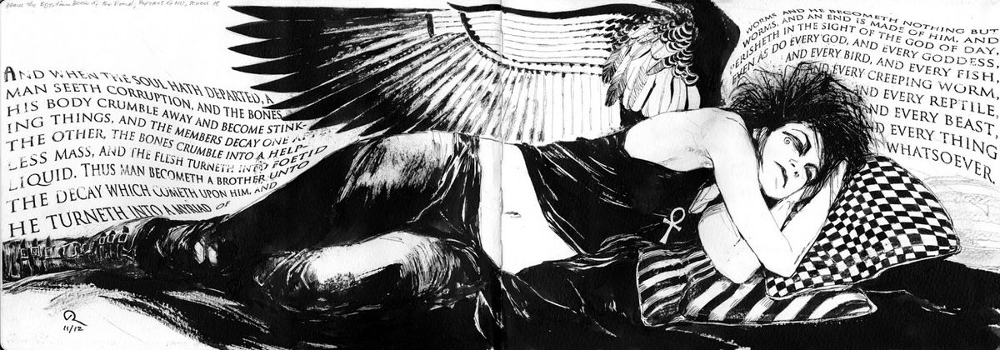

  

  <h1>Gabi Zanini</h1>
  
<em>entre perguntas e possibilidades</em>

## Sobre mim

Sou estudante de Ciência da Computação na PUCRS e trabalho com engenharia de dados e DataOps, atuando na análise, construção e operação de fluxos de dados.

Gosto de estruturar projetos, investigar problemas e entender como sistemas e processos se conectam, com foco em automatizar pipelines e torná-los mais eficientes e confiáveis.

## Tecnologias

   Python &nbsp;&nbsp;
   SQL &nbsp;&nbsp;
   PySpark &nbsp;&nbsp;
   Pandas &nbsp;&nbsp;
   Haskell &nbsp;&nbsp;
   C &nbsp;&nbsp;
   Assembly &nbsp;&nbsp;
   Java &nbsp;&nbsp;
   Linux &nbsp;&nbsp;
   Git &nbsp;&nbsp;

---

  
  
<em>“Sem os momentos ruins, como você reconheceria os bons?”</em>

